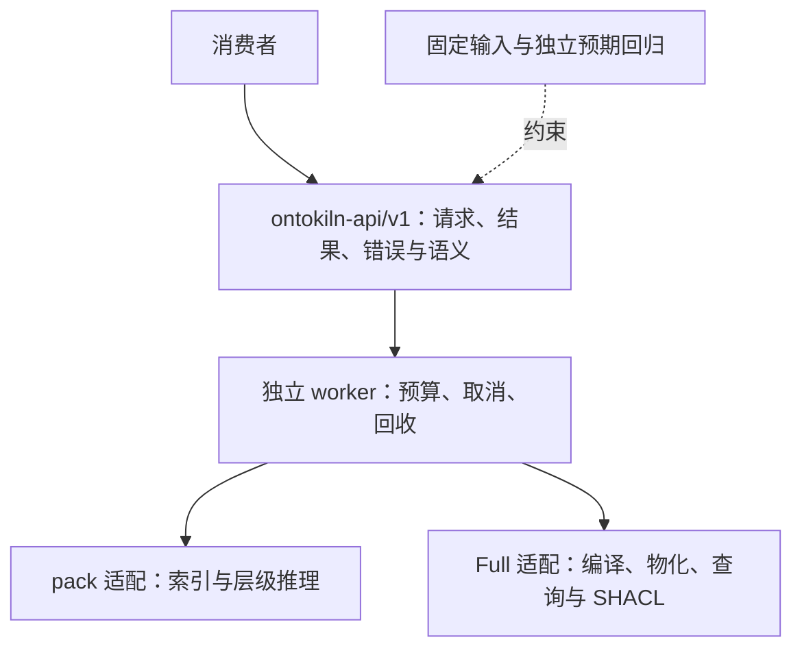

# 消费者契约 v1

`ontokiln-api/v1` 是面向消费者的稳定 JSON 文件协议。实现入口为 [api.rs](../src/api.rs) 的 `Request` / `Operation` 和 `run_files`，CLI 为：

```sh
ontokiln api --request request.json --result result.json
```

同一接口主版本、同一语义快照、同一规则和请求条件下，内核优化不要求消费者修改调用代码，完整成功结果保持语义等价。构建 SHA、执行时间、内存与内部执行计划不属于结果等价比较；显式选择的读取格式由独立版本契约约束；运行资源变化可能使同一预算下的完成情况不同。超限、取消或能力缺失必须明确失败，不返回部分成功。

## 边界与兼容



- `api` 不接受后端选择开关。编译返回不透明的 `dataset` 路径，后续操作使用该路径；常规查询消费者只传回该路径。需要本地批量读取的消费者可依赖下文独立的 `ontokiln-sqlite-read/v1`，不能依赖未声明的内部表或跨快照词项 ID。适配器目前识别 Full 产物目录和已有 pack 文件。
- 既有 `full`、`compile`、`sparql`、HTTP `/v1/*` 与 Rust 模块继续提供原有行为。新入口默认 `asserted`；旧 Full 的默认 `closure` 不被修改。应用迁移应同时切换调用、启动能力检查、终态验证及发行 pin；保留旧入口不代表迁移后的应用继续调用旧协议。
- `src/full*`、未声明的磁盘表、pack 字节和构建身份属于内部协议或特定存储格式。`identity check` 仍用于精确版本核验，不作为 API 向后兼容判断。API 主版本与存储版本分别演进；旧物理文件的重编策略不等于 API 升级。
- `run_files` 使用当前可执行程序启动隐藏 worker。Rust 嵌入者须保留 CLI worker 分派，或调用发布的 `ontokiln api` 进程；直接调用旧 `full::execute` 不经过此契约及进程隔离。
- 本版覆盖本地 SELECT / ASK、编译、物化、SHACL 和能力查询。HTTP 模板、JSONL、证明导出等现有入口继续按原协议工作；本版不承诺逐事实证明。`require` 请求不存在的能力会明确失败。

## 请求

字段名、类型及未知字段拒绝由 Rust 的 Serde 类型执行，见 [Request / Operation / Limits](../src/api.rs)。禁止将任意内部 JSON 透传为公开请求。

```json
{
  "contract": "ontokiln-api/v1",
  "request_id": "lookup-1",
  "operation": {
    "kind": "query",
    "dataset": "/data/snapshot",
    "query": "SELECT ?s WHERE { ?s a <urn:example:Item> }",
    "view": "asserted",
    "require": ["select-ask/v1"]
  },
  "limits": {"timeout_ms": 30000, "max_rows": 100000}
}
```

`contract` 和 `request_id` 必填；后者为 1～256 UTF-8 字节。未知版本返回 `UNSUPPORTED_CONTRACT`。未知字段、错误类型、非法枚举和无效预算返回 `INVALID_REQUEST`。路径按进程工作目录解析，推荐传绝对路径。请求文件最大 4 MiB。

| operation.kind | 字段与行为 |
|---|---|
| `capabilities` | 可选 `dataset`。无数据集时返回操作集合、默认视图和证明覆盖；有数据集时校验后返回其语义、profile、能力及可用视图 |
| `prepare_query` | `query`。检查本地 SELECT / ASK，拒绝远端访问；返回 `valid: true` |
| `rules` | `profile`、`files: [{path, expected_sha256}]`。冻结、校验并返回 `ontology-rule-ir/v1` 的 `rules` 数组 |
| `compile` | `sources`、`output`、`profile`，可选 `rules: []`、`import_lock`、`expected_source_tree_digest`。冻结输入并验证 SHA-256，原子发布新快照；输出路径必须不存在 |
| `materialize` | `dataset`、`output`。读取已编译快照的规则计划，求不动点并发布新快照；失败不覆盖原数据 |
| `query` | `dataset`、`query`；可选 `parameters: {}`、`rdf_bindings: {}`、`view: asserted`、`revision`、`require: []`。仅本地 SELECT / ASK，不允许 FROM / SERVICE |
| `validate` | `dataset`；可选 `shapes: []`、`shapes_from_dataset: false`、`selected_shapes`、`focus_node`。只能选择外部 Shapes 或数据集内 Shapes；不支持 pack |

`sources` 和外部 `shapes` 的元素为 `{path, document_id, format, expected_sha256, base_iri?}`；`format` 为 `turtle`、`ntriples`、`trig` 或 `nquads`。源文件必须是普通非符号链接文件，摘要为实际字节的 SHA-256。编译时 `document_id` 隔离空白节点；外部 Shapes 的空白节点独立解析。`rules` 元素为 `{path, expected_sha256}`。

编译 profile 必填，可选 `no-rules-v1`、`datalog-v1`、`rdfs-supported-v1`、`rdfs-property-chain-v1`；规则格式与含义见 [Full 合同](full.md)。只解析已冻结的本地本体声明，不联网获取 imports。RDF 词项默认最大 1 MiB，可用 `limits.max_term_bytes` 显式调整；严格解析，不提供隐式业务修复。`import_lock` 为 ontology IRI 到 document ID 或 ID 数组的映射；null 使用冻结声明自动解析，空对象是禁止未声明映射的显式锁。`expected_source_tree_digest` 按冻结来源清单核对 SHA-256，失败不发布产物。

`parameters` 使用显式 `urn:ontokiln:param:NAME` 槽。IRI 为 `{"type":"iri","value":"urn:x"}`；字面量为 `{"type":"literal","value":"文本","language":"zh"}` 或带 `datatype` 的形式。`language` 与 `datatype` 不能同时提供。多余、缺失和非法参数被拒绝；SPARQL 变量仍有自身作用域。

`rdf_bindings` 是独立的变量初始绑定机制，值为合法 N-Triples RDF 词项字符串，变量名不含 `?`。它保持 SELECT 列、FILTER/BOUND 和 ORDER BY 的变量语义，允许同一快照的空白节点；不通过文本替换查询实现。只有声明 `rdf-bindings/v1` 的数据集支持，pack 暂时明确拒绝。

## 快照语义

| 快照 | 语义与可用能力 |
|---|---|
| 既有 pack | `pack-rdfs-hierarchy/v1`；默认图为所选文档的去重并集，asserted 命名图是文档图；层级推理与版本隔离维持原语义。能力含 `document-graphs/v1`、`revision/v1` |
| Full | `rdf-dataset-union/v1`；存储保留 RDF 图名，SPARQL 默认图为所有可见图的去重并集，GRAPH 使用原始 RDF 图名；规则以冻结 profile / plan 为准。能力含 `rdf-named-graphs/v1`、`shacl/v1`；不支持 pack 的 revision 投影 |

两者共同提供 `select-ask/v1`、`views/v1`。不同图语义、不同规则 profile 不能仅因接口相同就互换。未来替换存储适配器时必须保留原快照的语义和能力，不能将 Full 具名图自动解释为 pack 文档图。

`asserted` 为原始事实；`inferred` 为新增推导事实；`closure` 为两者并集。Full 先按四元组的 explicit 标记筛选，再投影默认图；同一 SPO 在不同图的显式 / 推导状态可以不同。pack 按所选版本的三元组区分，显式声明优先。Full 带规则的 compiled 快照只允许 asserted，完成物化后才允许 inferred / closure；`no-rules-v1` 的 compiled 快照可直接查询三个视图。reasoned 快照必须记录已完成不动点。pack 的层级视图由受预算约束的查询求值生成。

Full 查询与校验先校验 manifest / 文件摘要，再按已验证摘要复制数据库到本次 worker 的私有临时目录。pack 复用加载器的私有只读快照。外部 Shapes 也先核验摘要再冻结。复制和求值都处于执行预算内。

## 响应与完整性

所有正常写出结果文件的请求都使用同一 envelope：

```json
{
  "contract": "ontokiln-api/v1",
  "request_id": "lookup-1",
  "request_sha256": "<原始请求文件摘要>",
  "status": "COMPLETE",
  "result": {},
  "error": null,
  "execution": {"worker_reaped": true, "worker_pid": 12345},
  "kernel": {"contract_version": "ontokiln-core/v3"}
}
```

`execution` 还包含 `supervisor_pid`、`integrity_checked` 和实际执行的 `metrics`：`peak_rss_bytes`、`supervisor_peak_rss_bytes`、`peak_scratch_bytes`、`execution_seconds`。未启动 worker 的请求不要求 metrics。产物所有权回执绑定原始公开请求的摘要和 supervisor PID，供宿主在强杀后仅清理本次输出。

`kernel` 实际包含完整构建身份，示例省略其余字段。未启动 worker 时 `worker_pid` 为 null。只有 `status=COMPLETE`、`error=null` 且 `worker_reaped=true` 才能消费成功结果。错误响应的 `result` 必须为 null。无效 JSON 无法提供 ID 时，`request_id` 为 null。结果文件原子写入；不可读请求、请求过大或结果文件 I/O 失败属于进程失败，调用方还须检查退出码和本次结果文件，不能复用旧响应。

| result 类型 | 固定内容 |
|---|---|
| 查询 | `query_type`、`variables`、`items`、`boolean`、`view`、`complete=true`、`truncated=false`、`proof_coverage`。SELECT 的 boolean 为 null；ASK 的 variables / items 为空 |
| 编译 / 物化 | `dataset`、`stats.explicit_facts`、`stats.inferred_facts`、`fixpoint_reached`、`proof_coverage`、`read_contract` 和 `artifact`（路径、manifest / 内容 / 来源摘要、语义指纹、profile） |
| 校验 | `conforms`、`checked_shapes`、结构化 `report`（含 violations）。不符合 Shape 是正常校验结果，不是执行失败 |
| 能力 | `operations`、`default_view`、`proof_coverage`，以及按请求提供的 `dataset` 元数据 |

查询词项为 SPARQL JSON 的 `uri`、`bnode`、`literal` 对象；保留词法、datatype 和 `xml:lang`。普通字符串统一显式标记 `xsd:string`。不支持的结果词项明确拒绝。未绑定变量不出现在该行中。SELECT 保留重复解；只有 ORDER BY 承诺指定顺序。空白节点标签可合法重命名，等价比较需保留同一结果内的节点关系，不能按标签字节比较不同快照。

本版 `proof_coverage` 固定为 `{"per_fact":"not_recorded"}`，不把结果数量、闭包或成功终态当作逐事实证明。

| error.code | status |
|---|---|
| `INVALID_REQUEST`、`INVALID_DATASET`、`INVALID_QUERY`、`EXECUTION_FAILED` | `FAILED` |
| `UNSUPPORTED_CONTRACT`、`UNSUPPORTED_CAPABILITY` | `UNSUPPORTED` |
| `RESOURCE_EXHAUSTED` | `BUDGET_EXHAUSTED` |
| `CANCELLED` | `CANCELLED` |

客户端按 code 判断，不匹配诊断 message。可选细分 `error.reason` 保留 `SOURCE_INVALID`、`RULE_INVALID`、`TTL_PARSE_ERROR`、`UNSUPPORTED_RULE_PROFILE`、`FORMAT_VERSION_UNSUPPORTED`、`MANIFEST_CORRUPT`、`QUERY_FAILED`、`VALIDATION_FAILED`、`RESOURCE_LIMIT_EXCEEDED`、`BUDGET_EXHAUSTED`、`FIXPOINT_LIMIT_EXCEEDED`、`CANCELLED`；未知 reason 必须退回稳定 code。对 supervisor 发 SIGTERM / SIGINT 会终止并 wait worker 后写 CANCELLED；超时、RSS 或临时磁盘预算失败同样回收 worker。系统强杀或 I/O 失败可能没有终态文件，不能解释为成功。

## 预算

`limits` 可省略；字段省略时使用下表默认值。`memory_bytes`、`scratch_bytes`、`timeout_ms` 的显式 null 表示调用方取消该项预算，其余字段不接受 null；仍保留取消与进程回收。预算是执行许可，不是性能承诺。

| 字段 | 默认值 |
|---|---|
| `memory_bytes` | 512 MiB，supervisor 与 worker 的 RSS 预算 |
| `scratch_bytes` | 4 GiB，临时目录与 staging 预算 |
| `timeout_ms` | 300,000 ms |
| `max_rows` | 100,000；Full 可显式增大，ASK 计一行 |
| `max_bytes` | 4 MiB；Full 可显式增大 |
| `max_iterations` | 100 |
| `max_derived_facts` | 1,000,000 |
| `max_intermediate_rows` | 10,000,000 |
| `max_validation_depth` | 64 |
| `max_term_bytes` | 1 MiB |

`max_bytes` 检查规范化查询 payload `{query_type, variables, items, boolean}` 的紧凑 UTF-8 JSON 字节数，不包含 envelope。内部扫描、序列化和内存保护仍可提前拒绝请求；不会为了保持完成率突破预算。RSS 为采样及进程高水位验收，不承诺任何瞬时值绝不越界。SHACL 仍使用内存图，受独立进程预算限制。

## 契约回归与升级规则

[固定语料](../tests/fixtures/contract-v1/README.md) 含恰好 10,000 条显式 RDF 三元组。`schema.ttl` 为 19 条，`data.ttl` 为 9,981 条；两份文档中的同名空白节点互不合并。生成器和 SHA-256 manifest 检查输入漂移，编译器的实际事实数断言检查解析结果。

```sh
python3 -B tests/fixtures/contract-v1/generate.py --check
cargo test --locked --test api
```

[cases.json](../tests/fixtures/contract-v1/cases.json) 保存独立人工预期；[api.py](../tests/api.py) 同时核对预期与 pack / Full 共同子集差分。覆盖默认值、三种视图、JOIN / FILTER、重复解、排序、类型词法、参数、文档空白节点、能力拒绝、SHACL、输入损坏、原子发布、字节预算、超时和真实 worker 取消。旧接口继续由既有 Full / HTTP / 引擎测试验证。

变更内核必须运行同一套消费者测试。不能只改预期以消除失败；有意改变旧语义、默认值、必填字段、错误码或删除能力时，应新增主版本并给出迁移。构建指纹变化不要求 API 升级。10,000 条数据是契约与机制回归，不是亿级性能证明。

## 本地读取产物契约

`ontokiln-sqlite-read/v1` 是显式支持的批量读取格式，与 API 主版本分别演进。当前 Full 编译和物化直接产生该格式，manifest 通过 `read_contract` 声明它；`capabilities.read_contracts` 表示引擎支持。以后内核换存储、索引或推理实现，仍须通过适配器输出相同读取格式，或提供新版本迁移，不能让应用直接跟随内部表变化。

- 文件集合、来源与内容校验沿用 `kernel-manifest-v1`：`facts.sqlite`、`plan.json`、`input_manifest.json` 及冻结输入文件。manifest 给出完整文件大小 / SHA-256、kind、profile、source_tree_digest、semantic_fingerprint、stats、completion；reasoned 还记录 compiled_content_digest 与 fixpoint_reached。只有完整性核验通过的只读产物可消费。
- `terms(id, n, kind, value, datatype, lang)`：`n` 为 N-Triples 词项，kind 为 I / B / L；空 datatype/lang 用空字符串。ID 仅在该产物内有效。
- `facts(g, s, p, o, explicit)`：四元组集合，s/p/o 与非零 g 引用 terms；g=0 为默认图；explicit=1 为断言，0 为新增推导。同一四元组若已有断言，显式标记优先。
- `source_documents(id, document_id)` 与 `source_facts(g, s, p, o, document)` 保留显式事实的全部来源，document 引用 source_documents。同一事实的多个来源不能被去重丢失；物化不伪造新增事实的显式来源。
- 额外工作表、索引选择、SQLite 页布局和行序不在契约中。默认图的去重并集语义不变；必须按词项及来源比较，不能比较不同构建的 ID。
- `capabilities.runtime` 提供诊断与读取版本元数据；消费者使用 API / read_contract 协商能力，发行校验另核对实际源码及二进制摘要。

10,000 条固定 RDF 回归同时验证读取表、显式数量、来源引用、变量绑定、规则检查、无超时选项及发布回执的请求所有权，防止上层适配只改命令名而遗漏执行语义。
