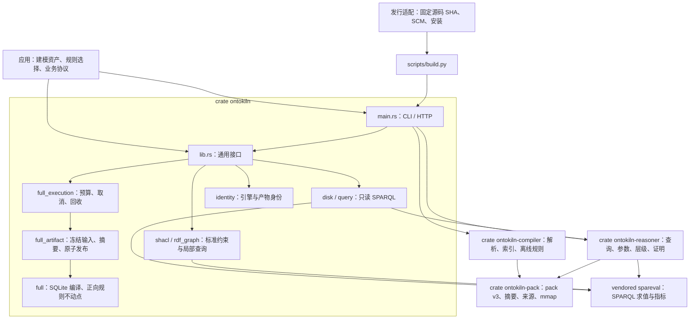

# 通用 Full、SHACL 与构建合同

需要与内核演进隔离的消费者使用 [API v1](api-v1.md)。下文保留原 Full / Rust 入口合同；新入口通过显式适配复用其计算和执行生命周期，不修改旧请求默认值。

OntoKiln 只处理 RDF 词项、图、规则和标准约束。应用负责选择输入、规则与 Shape，以及解释输出。任何自定义类名、谓词或 JSON 字面量都只是数据，不触发身份选择、源码定位、字段赋值、场景工作流或业务协议。示例程序不属于核心的隐式规则。



## Full 请求

`ontokiln full --request request.json --result result.json` 启动独立 worker。成功和失败都返回执行记录，包含请求摘要、引擎身份、终态与 `worker_reaped`。库调用 `full::execute` 本身不提供进程隔离；应用必须放在有预算的 worker 中执行。

编译请求示例（路径与 SHA-256 必须替换为真实输入）：

```json
{
  "operation": "compile",
  "sources": [{"path": "/data/input.ttl", "document_id": "input", "format": "turtle", "expected_sha256": "<sha256>"}],
  "artifact": {"output": "/data/compiled", "profile_id": "no-rules-v1", "index_profile": "core-v1", "rules_files": []},
  "memory_budget_bytes": 536870912,
  "disk_budget_bytes": 1073741824,
  "max_term_bytes": 1048576,
  "timeout_seconds": 60
}
```

产物目录含 `facts.sqlite`、计划及 manifest。`materialize` 使用 `artifact.compiled`、`artifact.output`，并接受 `max_iterations`、`max_derived_facts`、`max_intermediate_rows` 和相同进程预算。输出必须不存在；失败不覆盖旧产物。输入和规则文件先冻结，摘要不符即拒绝。Full 的 `proof_coverage` 是 `closure_only`，逐事实证明明确标为 `not_recorded`，不能当作 pack 的证明链。

支持 Turtle、N-Triples、TriG、N-Quads。空白节点按文档隔离；导入必须由冻结的 import lock 显式提供，不联网解析。严格拒绝不合法 IRI。历史资产修复与映射由资产生产方或应用完成。

规则使用 `ontology-rule-ir/v1` 的正向安全三元组/四元组程序。profile 包括 `no-rules-v1`、`datalog-v1`、`rdfs-supported-v1`、`rdfs-property-chain-v1`，不代表完整 OWL 2 RL。未知 profile、未绑定头变量和不支持的过滤器均失败。

`query` 请求指定 `dataset`（`facts.sqlite` 路径）、`query`、`view`（`asserted`、`inferred`、`closure`），可设 `query_seconds`、`max_rows`、`max_bytes`。返回 `items`/`boolean` 及读取指标。参数使用 `parameters`，在查询中以 `<urn:ontokiln:param:name>` 声明类型化槽；不会按变量名改写子查询作用域。旧 `params` 不被静默接受。禁止远程 SERVICE 和数据集 FROM。Full 查询的预算与 pack HTTP 预算分别生效，见各请求合同。

## SHACL

`validate` 指定 `dataset`（产物目录）和 `shapes: [{"file": "/data/shapes.ttl", "format": "turtle"}]`。默认选择声明的 NodeShape/PropertyShape。支持 SHACL Core、局部 SELECT、参数化 ASK validator / target，以及逻辑组合中的 focus 传播。不支持的 Shapes 谓词和远程导入/查询明确失败。

编译、物化和 Full 查询使用 SQLite；SHACL 校验会在受 RSS 限制的 worker 中装载数据图。它不是磁盘原生的无限规模 SHACL。超时、取消、内存或磁盘超限必须回收 worker，不发布部分结果。

## 身份与发行

`identity` 返回 `ontokiln-core/v3`、源码提交、源码与特性指纹、pack 版本和通用能力。`inspect --pack FILE` 校验并报告 pack v3 的摘要、来源与引擎身份；`check --pack FILE --expected identity.json` 要求完全一致。HTTP `GET /v1/identity` 使用服务已验证的私有快照，不重开可能被替换的源文件。旧 pack 必须从输入重编；业务历史格式的适配属于消费者。

```sh
python3 -B scripts/build.py --output /tmp/ontokiln-build
```

构建入口要求干净的固定 Git 提交，在原生 macOS/Linux arm64/x86_64 主机安装固定工具链、执行 release workspace 测试并构建，然后产出确定性 tar.gz 与 `build.json`。Linux musl 需要主机提供 `musl-gcc`。交叉编译不能代替原生运行验证。receipt 分别记录源码、lockfile、构建入口、二进制及归档摘要。开发中的脏树可直接 cargo build，其指纹标识源码内容；发行必须通过干净提交检查。确定性归档不等于已经证明跨主机二进制逐字节可复现。

内网 SCM 包装层可选择镜像地址，但必须验证同一个完整上游提交，并调用此入口。包装层提交和核心提交必须分别记录，不得将包装层 SHA 注入核心身份。

The Rust `full_artifact::compute_with` entry point lets an embedding application adapt execution after inputs have been frozen, while retaining the core artifact lifecycle. A source may explicitly set `unchecked_turtle_terms: true` to use the Turtle parser's unchecked term mode; strict parsing remains the default. Callers own any additional validation policy. This option never changes source bytes and carries no identifier-specific exceptions.

### Focused validation

`validate` accepts optional `selected_shapes` (an array of N-Triples resource terms) and
`focus_node` (one N-Triples IRI or blank node). Omitted shapes select all declared NodeShape/PropertyShape
resources; omitted focus uses their declared SHACL targets. An explicit empty selection checks no
shapes. Unknown shapes and literal selectors fail. `max_validation_depth` is a positive integer
(default 64), enforced by the evaluator. The caller owns shape and focus selection; the engine
does not dispatch on vocabulary or application profiles.

### Query input bindings and shared shape graphs

`rdf_bindings` binds RDF terms before evaluating a local SELECT. Input variables may occur only in FILTER or ORDER BY; they do not become output columns. Queries with such bindings skip optimizer folding that would otherwise treat these variables as unbound. Unbound queries retain the existing optimizer. Explicit `parameters` IRI slots remain the preferred template contract.

`validate` accepts `shapes_from_dataset: true` with `shapes: []` when constraints and data belong to the same compiled RDF dataset. This preserves document-scoped blank node identity, including `sh:targetNode` and `sh:hasValue`. External shape documents remain independently scoped; the two modes cannot be combined.
