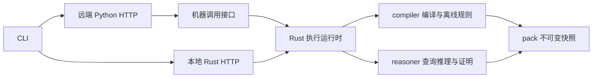

# Python 与 Rust 边界设计

设计提案 · 2026-11-10

目标部署包含两种链路：CLI 访问远端 FaaS，由 Python 提供 HTTP 服务并调用 Rust 内核；CLI 访问本地 Rust HTTP 服务，由本地 pack 提供数据。编译主要在 FaaS 执行，推理同时支持本地和远端。

Rust 负责完整的编译、快照、推理和受控执行能力，Python 负责远端服务编排。两端复用相同的数据语义、证明、预算执行和结果契约。编译部署在 FaaS 不改变编译器的归属：编译器仍是 Rust 库，并保留本地 CLI 入口用于复现与验证。

本文定义目标边界和落地顺序。当前可用接口、规则范围和资源限制见[查询服务](query-service.md)、[引擎说明](engines.md)与 [README](../README.md)；下文新增的运行时和机器调用接口尚未实现。

## 部署与复用关系

机器调用接口可以通过进程通信实现，远端不要求再部署一套对外 Rust HTTP 服务。Rust HTTP、CLI 和 Python 适配器都调用同一运行时，避免各自实现超时、取消、结果完成判断和错误分类。

Rust 内核分为语义核心与执行运行时。语义核心包含 compiler、pack 和 reasoner，不依赖 HTTP 或云平台；执行运行时负责快照持有、任务隔离、预算和生命周期。HTTP 状态、鉴权、对象存储与云端任务状态留在各自的适配和编排层。

## Rust 提供的能力

| 能力 | Rust 的职责 |
|---|---|
| RDF 编译 | 解析 Turtle 和 N-Triples，稳定扫描文件，隔离文档内空白节点，编码、排序、去重并保留全部断言来源，验证源码与 RDF 摘要，生成索引与 pack |
| 快照管理 | 校验格式、摘要、字典、索引边界和来源；创建私有只读快照并映射；管理快照生命周期；提供来源、revision 和兼容性元数据 |
| 查询与推理 | 单主语、批量、类型集合与 SPARQL；类型化 RDF 参数绑定；版本选择；asserted、inferred、closure 视图；层级推理与离线规则求值 |
| 证据 | 返回断言来源和一条确定性的有根证明，记录规则版本，支持证明导出；每个前提都必须在所选版本可见 |
| 受控执行 | 工作进程隔离，扫描、堆、输出和时间预算，取消、背压、异常回收；终止并等待工作进程退出后释放执行槽 |
| 机器契约 | 结构化请求、结果流、稳定错误类别、完成标记、执行统计，以及引擎、规则、pack 和协议的版本信息 |

规则范围沿用现有实现：在线提供 RDFS 层级规则，Datafrog 和 Ascent 用于受限的离线规则求值。本设计不把业务场景实验、完整 OWL 或通用规则语言视为已经支持的内核能力。

## Python 与 Rust 的职责边界

| 环节 | Python 负责 | Rust 负责 |
|---|---|---|
| 输入准备 | 接收上传、下载对象、准备完整任务目录 | 解释 RDF，检查输入及来源的一致性 |
| 编译任务 | 队列、任务状态、重试、云端资源选择 | 实际编译、诊断、产物和执行统计 |
| 数据发布 | 上传 pack、登记快照、更新数据集版本指针 | 生成完整 pack，验证格式和可加载性 |
| 查询入口 | 身份、租户、权限，选择允许访问的快照、revision 和模板 | 参数绑定、版本约束、查询与推理 |
| 资源策略 | 按租户或套餐确定配额，跨实例限流 | 校验并执行单任务预算，管理实例内执行槽 |
| 响应与取消 | HTTP 状态映射、结果转发、感知客户端断连并发送取消 | 产生结果、停止计算、回收工作进程、确认终态 |
| 观测 | 请求链路、排队和下载耗时、云端任务记录 | 候选行、输出量、Rust 堆、算子统计及执行失败原因 |

Python 决定请求允许访问什么，Rust 在实际执行中保证版本与视图语义。例如请求被授权访问 v2，Rust 必须在扫描和推理前选择 v2，并使证明的每个前提遵守该选择。先跨版本推理、再由 Python 过滤结果会引入错误结论和证据。

Python 可以管理模板和规则资产的发布、版本及权限；模板解析、RDF 参数绑定和规则求值由 Rust 完成。需要两端一致的业务选择逻辑应成为版本化的模板或规则资产，交给共同引擎执行。现有 HTTP 仅运行注册的只读模板，这一约束应在 Python 入口保留；内部机器接口不等于向外部客户端开放任意查询文本。

## 数据与快照交接

大数据通过文件和快照交接，控制信息通过结构化协议交接。Python 不解析 pack 内部布局，也不将大批三元组转换成 Python 对象后再传给 Rust。词项 ID 仅在单个快照内有效，对外参数与结果继续使用完整 RDF 词项或明确限定快照的引用。

编译链路为：

1. Python 准备完整输入目录，包括 RDF、来源清单及清单要求核对的源码。
2. Rust 编译并生成 pack、结构化报告和产物摘要；本地文件采用临时写入后原子替换。
3. Python 在任务成功后上传不可变产物，完成发布记录，再更新数据集引用。失败任务不改变已发布引用。

查询链路为：

1. Python 完成授权，将数据集引用解析为确定的 pack，并准备本地文件。
2. Rust 加载、校验并创建私有只读快照，返回实例内句柄。
3. 每次查询固定快照、revision、模板和规则版本，Rust 执行并输出结果。
4. Python 按背压转发结果；客户端断连时向 Rust 发送取消。

需要区分以下身份与版本：

| 标识 | 含义 |
|---|---|
| 快照身份 | 确定的不可变 pack，建议以完整产物的内容摘要标识；与 pack 内部正文摘要明确区分 |
| 来源 revision | 在一个 pack 内选择哪些来源文档参与查询和推理 |
| 模板与规则版本 | 本次查询和推导所使用的程序身份 |
| pack 格式版本 | 文件布局与加载兼容性；当前仅支持 v3 |
| 机器协议版本 | Python 与 Rust 请求、响应和错误结构的兼容性 |

一次执行开始后固定快照身份。云端 latest 指针变化不影响已经接受的执行。快照句柄属于持有它的运行时实例，不能跨 FaaS 实例或跨重启复用；活跃任务期间必须保持快照有效。

Rust 工作进程继承已经验证的私有只读快照 FD，不重新打开用户提供的原始路径。当前 [Pack::load](../crates/pack/src/lib.rs) 会复制输入到私有文件并校验，加载阶段需要预留约一份 pack 的临时磁盘。复用快照句柄可避免同一暖实例对每次查询重复复制和校验大 pack。

跨环境重编还需要稳定的逻辑输入身份。当前[编译器](../crates/compiler/src/lib.rs)默认以物理文件 URL 为相对 IRI 的 base；未声明稳定 base 的相对 IRI 可能随 FaaS 临时目录改变。需要明确逻辑文档 base 的输入契约，或要求输入使用绝对 IRI、稳定的显式 `@base`。重建一致性的输入定义必须包含这一条件。

## 进程边界与资源控制

第一阶段采用子进程与版本化机器协议。编译可使用一次性 Rust 进程；查询在 FaaS 支持本地子进程的前提下，可由暖实例中的 Rust supervisor 持有已验证快照，每次请求启动独立 worker。冷实例按需重新加载，正确性不依赖暖实例是否保留。

当前[堆计量器](../src/allocation.rs)在超限时调用 `_exit`，依赖独立工作进程提供隔离。将查询计算直接嵌入 Python 进程需要重新设计硬终止、堆计量与故障隔离，不能直接沿用当前 worker 的退出方式。保留进程边界可以先复用现有保障，再根据实测启动成本评估后续绑定方式。

有效预算取用户请求、服务策略和引擎上限中的最小值。Python 下达服务策略，Rust 对传入预算执行合法性检查并落实限制。Python 的配额和跨实例限流不能代替 Rust 的扫描、堆、输出、时间和并发控制。

Python 负责端到端请求期限；Rust 负责被接受执行的期限。排队、下载或快照加载之后，Python 应传递剩余执行预算，而不能重新给予完整请求时间。取消和超时需要留出回收进程的余量。编译另设时间、内存、输入规模、产物和临时磁盘预算，不沿用在线查询的 5 秒限制。

取消必须贯穿 Python HTTP、机器通信、supervisor 和 worker。收到取消或检测到客户端断连后，运行时终止并等待 worker，再释放槽。机器通信断开时的任务归属和取消行为也要明确，避免遗留无调用方的查询。

结果传输使用有界缓冲维持背压，避免 Python 为了转发而把整个结果积存在内存中。查询堆、累计分配、共享 mmap、进程 RSS 与 Python 内存分别计量；Rust 堆上限不代表整个 FaaS 实例的内存上限。

## 机器调用契约

首版接口按以下操作收敛，名称表达语义，具体线协议在实现时固定：

| 操作 | 输入 | 输出 |
|---|---|---|
| compile | 输入目录、编译配置、编译预算、任务 ID | pack、摘要、诊断、统计和成功或失败终态 |
| open_snapshot 与 inspect | 已准备的文件、预期摘要；或已加载的快照句柄 | 快照句柄、来源、revision、规模与兼容性信息 |
| execute | 快照句柄、查询操作或模板、类型化参数、视图、revision、预算、执行 ID | 结果流、统计、成功或失败终态 |
| cancel | 当前实例内的执行 ID | 取消受理情况；执行流最终报告终态 |
| capabilities | 协议版本或能力查询 | 支持的 pack、协议、规则版本，操作、构建特性和限额 |

快照生命周期还需定义释放行为：空闲快照可以释放或淘汰，仍被执行引用的快照必须保留到任务回收。第一阶段可以保留当前单快照实例模型，不要求同时实现多快照热切换。

机器协议的标准输出只承载协议数据，诊断日志独立输出。请求与事件携带任务或执行 ID。稳定错误类别应覆盖无效输入、不支持的格式、快照损坏、预算超限、超时、取消、执行槽繁忙和内部失败；Python 不通过匹配 stderr 文本判断错误。

HTTP 适配器将错误类别映射到既有状态：无效参数或版本为 400，预算超限为 422，超时为 408，主动取消为 409，槽满为 429。已经开始发送的流使用终端错误记录；现有详细行为以[查询服务](query-service.md)为准。

JSONL 保留现有完成约定：只有 `{"end":true,...}` 表示完整成功。supervisor 确认 worker 成功退出后才发布成功结束记录；读取到 EOF 本身不代表成功。Python 不补造结束记录，不将部分结果包装成完整结果。协议扩展应保留这些语义，并区分取消已受理与执行已回收。

## 仓库落地顺序

当前核心库与目标边界基本一致，主要耦合位于运行时和适配层：

| 位置 | 当前状态与调整方向 |
|---|---|
| [compiler](../crates/compiler/src/lib.rs) | 已提供目录编译；补充编译任务报告、独立预算和稳定文档 base 契约 |
| [pack](../crates/pack/src/lib.rs) | 已提供校验、原子保存和私有只读快照；将句柄生命周期与 inspect 能力通过运行时暴露 |
| [reasoner](../crates/reasoner/src/lib.rs) | 继续承载参数、版本、视图、推理和证明语义 |
| [execution](../src/execution.rs) | 目前依赖 App、ApiError 和 Axum Response；抽出不依赖 HTTP 的任务监督与结果流接口 |
| [worker](../src/worker.rs) | Job 与 Operation 可作为机器契约的起点；隐藏的 query-worker 依赖内部 FD 约定，不直接作为稳定公共接口 |
| [allocation](../src/allocation.rs) | 保留在隔离 worker 的执行边界，继续由 supervisor 解释预算退出 |
| [queries](../src/queries.rs) 与 [main](../src/main.rs) | 保留 CLI 和 HTTP 适配职责，调用共同运行时并映射结果 |

建议按以下顺序实施：

1. 抽出 Rust runtime 和机器协议，统一执行、错误、预算、取消与完成语义；现有 CLI 和 Rust HTTP 先接入。
2. 增加 Python 薄适配层，实现授权后的快照与模板选择、进程通信、背压转发和断连取消。
3. 补齐 FaaS 编译契约，包括结构化报告、独立资源预算、可取消任务、产物身份与可复现输入。
4. 根据冷启动、加载、点查和批量实测，决定快照缓存与进程复用策略。

## 验收要求

同一 pack、模板、参数、revision、视图和预算，经 CLI、本地 Rust HTTP、远端 Python HTTP 应得到一致的语义结果、来源、证明、候选行计数和错误类别。耗时、分配和进程内存等环境相关指标分别报告，不要求数值相同。无显式排序的 SPARQL 结果按解及其重数比较，不额外承诺行顺序。

验证应覆盖：

- 编译成功、输入错误、取消、预算不足与发布失败；失败任务不改变已发布快照。
- 稳定逻辑输入在不同临时目录重编的一致性，以及本地和远端读取同一 pack 的一致性。
- 版本隔离、同名 IRI、类型化参数、视图、全部可见来源和证明前提。
- 真实 HTTP 的首行前断连、流式传输中断连、主动取消、超时和慢客户端；确认工作进程退出后才释放槽。
- 流缺失成功结束记录、worker 异常退出和机器通信断开时，不把部分结果判为成功。
- 冷实例加载与暖实例快照复用；分别记录下载、复制校验、执行、转发、堆和 RSS。

运行时调整继续复用现有[真实 HTTP 回归](../tests/query_service.py)和[引擎回归](../tests/engines.rs)。不能以仅检查取消标志的模拟测试代替实际断连和进程回收验证。优化器或预算变化另按 [AGENTS.md](../AGENTS.md) 执行相应回归与基准。
